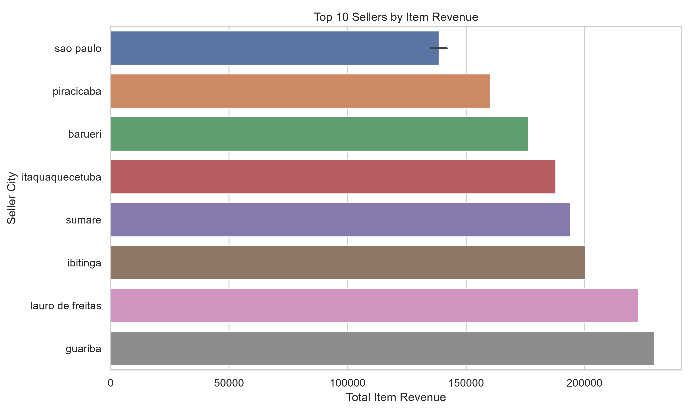
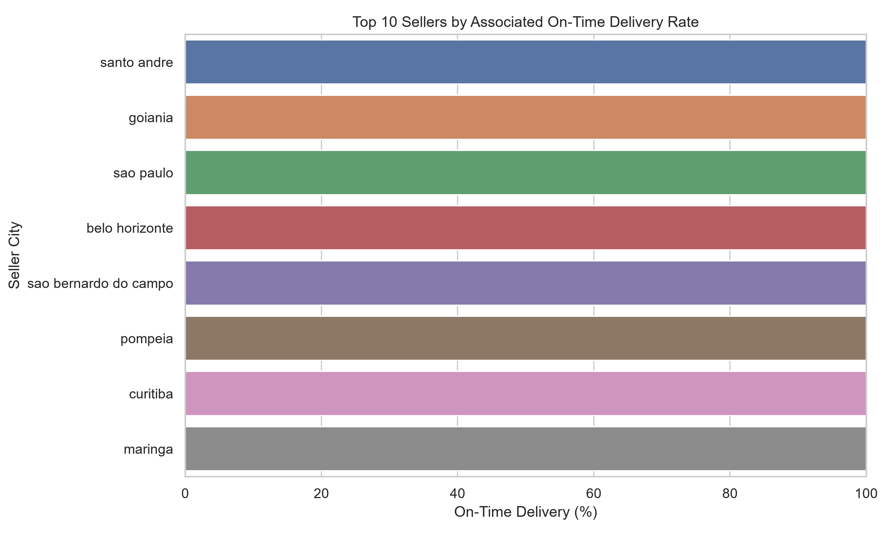
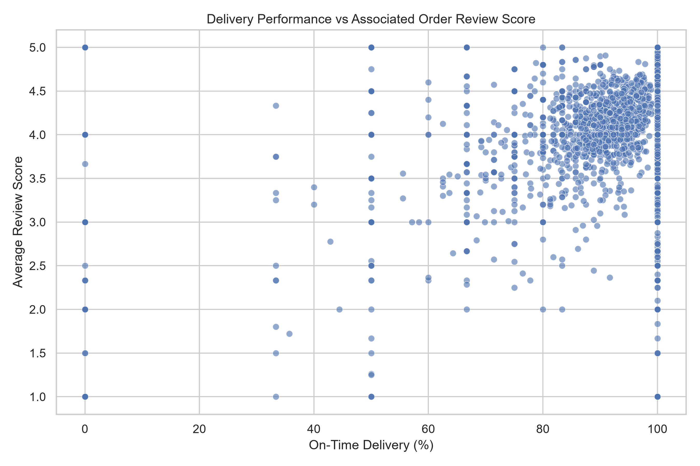

# E-commerce Seller Performance Analysis

An exploratory data analysis project using Python, Pandas, SQL and data visualisation to evaluate seller performance in a Brazilian e-commerce marketplace.

The project examines sales performance, delivery reliability and customer reviews to identify patterns and potential business improvement opportunities.

## Project Overview

The analysis uses the Brazilian E-Commerce Public Dataset by Olist to investigate five business questions:

- Which sellers generate the highest item revenue?
- How does delivery performance vary across sellers?
- Which sellers have the highest associated customer review scores?
- Are high-revenue sellers also associated with strong delivery and review performance?
- Where could the marketplace investigate potential seller performance issues?

## Tech Stack

- **Python:** Pandas, NumPy
- **Visualisation:** Matplotlib, Seaborn
- **SQL:** PostgreSQL-style analytical queries
- **Tools:** Git, GitHub, Windows Command Prompt

## Dataset

**Source:** [Brazilian E-Commerce Public Dataset by Olist – Kaggle](https://www.kaggle.com/datasets/olistbr/brazilian-ecommerce)

Four datasets were used:

- Orders
- Order items
- Sellers
- Order reviews

The project focuses on seller performance using item-level sales and order-level delivery and review information.

## Key Results

| Metric | Result |
|---|---:|
| Sellers analysed | 3,095 |
| Total item revenue | 13,591,643.70 |
| Delivered item revenue | 13,221,498.11 |
| Average seller-associated review score | 4.00 / 5 |
| Average seller-associated on-time delivery rate | 91.58% |
| Highest seller item revenue | 229,472.63 |

## Visualisations

### Top 10 Sellers by Item Revenue



### On-Time Delivery Performance



### Delivery Performance vs Associated Order Review Score



## Key Business Insights

1. **Revenue concentration:** Average seller revenue is substantially higher than median revenue, indicating an uneven revenue distribution.
2. **Delivery variation:** The average seller-associated on-time delivery rate is 91.58%, while the median is 100%.
3. **Customer experience:** The average seller-associated review score is 4.00 out of 5.
4. **Performance investigation:** High-revenue sellers with comparatively weaker delivery or review metrics may deserve further investigation.

## Project Structure

```text
ecommerce-seller-performance-analysis/
│
├── data/
│   ├── raw/
│   └── processed/
│
├── src/
│   ├── inspect_data.py
│   ├── seller_analysis.py
│   └── seller_visualizations.py
│
├── sql/
│   └── seller_analysis.sql
│
├── reports/
│   ├── figures/
│   └── business_insights.md
│
├── README.md
├── requirements.txt
└── .gitignore
```

## How to Run

### 1. Clone the repository

```bash
git clone https://github.com/nithyaa-d/ecommerce-seller-performance-analysis.git

cd ecommerce-seller-performance-analysis
```

### 2. Create and activate a virtual environment

```cmd
python -m venv venv
venv\Scripts\activate
```

### 3. Install dependencies

```bash
pip install -r requirements.txt
```

### 4. Add the dataset

Download the Olist dataset from Kaggle and place these four CSV files inside `data/raw/`:

- `olist_orders_dataset.csv`
- `olist_order_items_dataset.csv`
- `olist_order_reviews_dataset.csv`
- `olist_sellers_dataset.csv`

### 5. Run the analysis

```bash
python src/inspect_data.py

python src/seller_analysis.py

python src/seller_visualizations.py
```

The processed seller performance dataset is saved to `data/processed/`, and the charts are saved to `reports/figures/`.

## SQL Analysis

The `sql/seller_analysis.sql` file contains PostgreSQL-style analytical queries for:

- Seller revenue analysis
- Seller-associated delivery performance
- Seller-associated customer review scores
- Seller cancellation rates

These are provided as query examples and have not been executed against a PostgreSQL database as part of this project.

## Methodology and Limitations

- Item revenue is calculated using product prices and excludes freight charges.
- Delivery performance is based on order-level estimated and actual delivery dates.
- Customer reviews are recorded at order level, not seller level.
- When an order contains multiple sellers, its delivery outcome and review score may be associated with each seller.
- These metrics are therefore proxies for seller-associated performance, not direct measurements of individual seller responsibility.
- Sellers without eligible delivery or review records are excluded from the corresponding averages.
- Seller-level averages give each seller equal weight, regardless of order volume.

## Author

**Nithya Doresha**

Data Analyst | Analytics Engineer

- [LinkedIn](https://linkedin.com/in/nithyad2608)
- [GitHub](https://github.com/nithyaa-d)

Open to Data Analyst, Analytics Engineer and Data Engineering opportunities across Sweden. Open to relocation within Sweden.